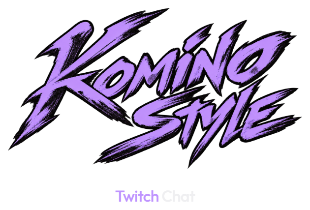
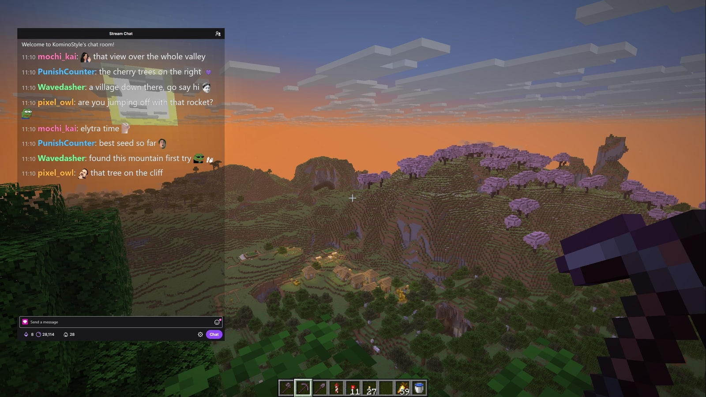
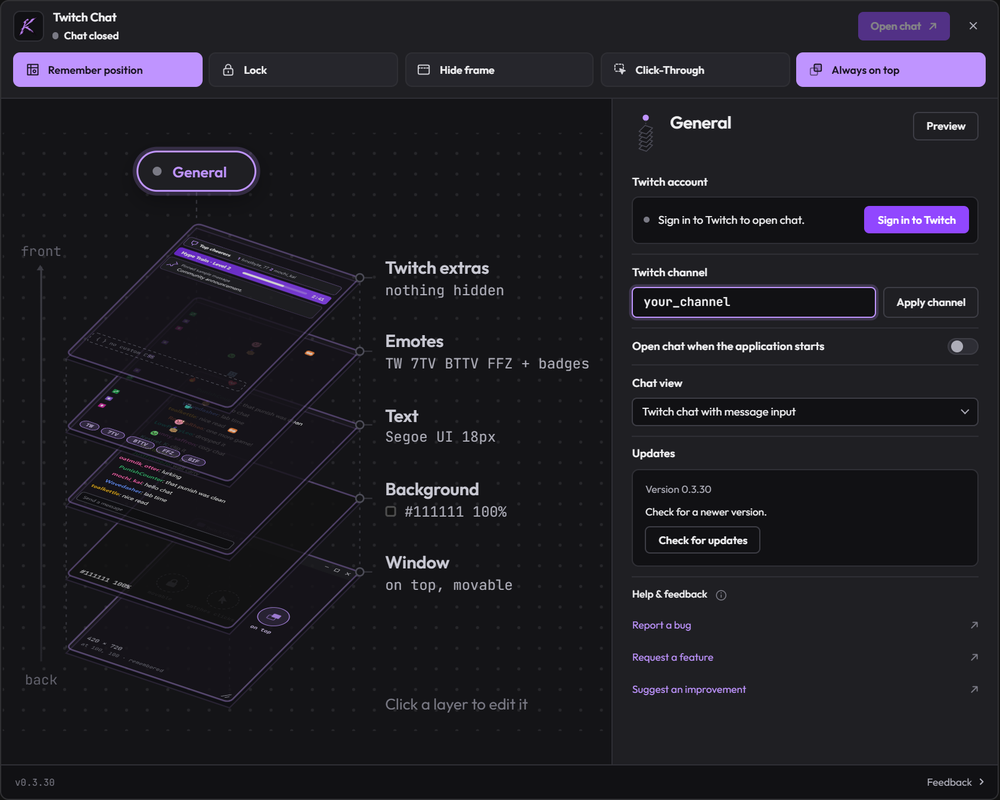
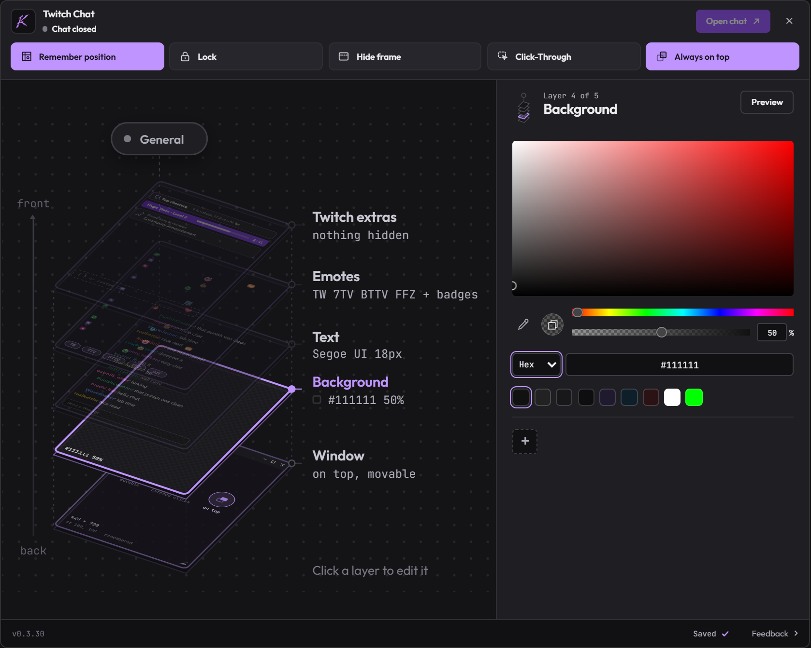
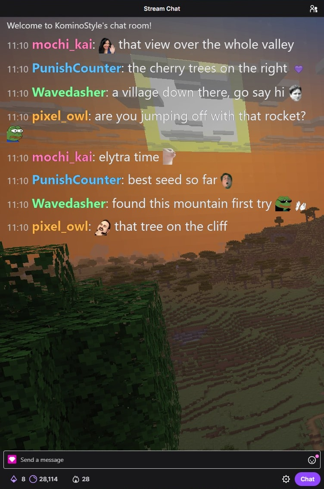
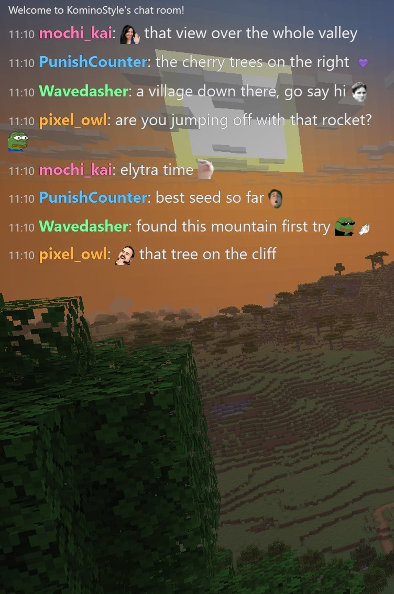

<h1 align="center">
  
</h1>

<h3 align="center">Float it. Style it. Read it.</h3>

  <b>Your Twitch chat, on top of whatever you're doing.</b> 
  Streaming, gaming or just hanging out: read and write in any channel's chat without switching windows.

  
  
  

  

  <a href="#how-it-works">How it works</a>&nbsp;&nbsp;|&nbsp;&nbsp;
  <a href="#settings">Settings</a>&nbsp;&nbsp;|&nbsp;&nbsp;
  <a href="#privacy">Privacy</a>&nbsp;&nbsp;|&nbsp;&nbsp;
  <a href="#status">Status</a>&nbsp;&nbsp;|&nbsp;&nbsp;
  <a href="#feedback">Feedback</a>

   
  Chat stays on top of your game, OBS or any other window.

> [!NOTE]
> Twitch Chat is an independent app and is not made by Twitch.

<table>
  <tr>
    <td width="25%" valign="top">
      <picture><source media="(prefers-color-scheme: dark)" srcset="images/icons/see-through-dark.svg"></picture><h3>See-through</h3>
      Background color and <b>opacity</b> from 0 to 100%. Text stays readable.
    </td>
    <td width="25%" valign="top">
      <picture><source media="(prefers-color-scheme: dark)" srcset="images/icons/always-on-top-dark.svg"></picture><h3>Always on top</h3>
      Hide the frame, <b>lock</b> the window or let clicks pass through to your game.
    </td>
    <td width="25%" valign="top">
      <picture><source media="(prefers-color-scheme: dark)" srcset="images/icons/emotes-dark.svg"></picture><h3>All your emotes</h3>
      <b>Twitch, 7TV, BetterTTV and FrankerFaceZ</b>, with Tab completion while you type.
    </td>
    <td width="25%" valign="top">
      <picture><source media="(prefers-color-scheme: dark)" srcset="images/icons/chat-dark.svg"></picture><h3>Real Twitch chat</h3>
      Write messages, use <b>channel points</b> and your own emotes, right in the window.
    </td>
  </tr>
</table>

## How it works

1. **[Download](#download) and install** `TwitchChat-Setup.exe`.
2. **Enter** a channel name in **General** and click **Apply channel**.
3. **Sign in** to Twitch. Your chat opens.

   
  Enter a channel and sign in.

4. **Style** it: click a layer to change Background, Text, Emotes or Window.

   
  Turn the background down to see your game.

## Chat views

Pick a view in **General**: write in chat, or just read it.

<table>
  <tr>
    <th width="50%">Twitch chat with message input</th>
    <th width="50%">Messages and emotes only</th>
  </tr>
  <tr>
    <td width="50%" valign="top"></td>
    <td width="50%" valign="top"></td>
  </tr>
</table>

## Settings

Changes save automatically.

| Section | What you change |
| --- | --- |
| **General** | Twitch account, channel, chat view, updates |
| **Window** | Always on top, frame, lock, Click-Through, size and position |
| **Background** | Color, opacity, saved color pairs, **Pick from desktop** |
| **Text** | Font, message, input and status font size, outline, spacing |
| **Emotes** | Emote providers, animations, GIFs, badges, celebrations |
| **Twitch extras** | Hide leaderboard, Hype Train, pinned messages or the Cheers button |

## Shortcuts

| Keys | What happens |
| --- | --- |
| <kbd>Tab</kbd> / <kbd>Shift</kbd>+<kbd>Tab</kbd> | Complete a username or emote, next or previous match |
| <kbd>↑</kbd> / <kbd>↓</kbd> | Bring back messages you sent in this chat |
| <kbd>Alt</kbd> + drag | Move the window while the frame is hidden |

## Privacy

Your Twitch sign-in **stays on your PC**, in the app's own session. **Sign out** clears it.
The app connects to Twitch, to 7TV, BetterTTV and FrankerFaceZ for their emotes, and checks for updates. You can turn each emote service off in **Emotes**. No ads.

## Status

> [!IMPORTANT]
> **Works today:** see-through chat window, writing in chat, channel points, Twitch, 7TV, BetterTTV and FrankerFaceZ emotes, in-app updates. 
> **Coming next:** a new **Chat tools** layer with your own highlights and sounds, big emote previews, automatic bonus Channel Points, a built-in guide.

## Download

Get the [latest release](https://github.com/KominoStyle/twitch-chat-installer/releases/latest) or browse [all releases](https://github.com/KominoStyle/twitch-chat-installer/releases). The installer always installs the newest version, and the app lets you know when an update is ready.

| System | Installer |
| --- | --- |
| Windows, 64-bit | [`TwitchChat-Setup.exe`](https://github.com/KominoStyle/twitch-chat-installer/releases/latest/download/TwitchChat-Setup.exe) |

> [!WARNING]
> Only download Twitch Chat from this page. Copies from other sites can contain malware.

## Uninstall

1. **Quit** the app from the tray.
2. **Uninstall** **Twitch Chat** in Windows Settings.
3. **Tick** **Also delete settings, Twitch sign-in and cached data** to remove everything the app saved on your PC.

Leave it unticked to keep your settings and sign-in for a later reinstall.

## Feedback

You can also open these from **Help & feedback** in the app.

| | |
| --- | --- |
| 🐞 [**Report a bug**](https://github.com/KominoStyle/twitch-chat-installer/issues/new?template=01-bug-report.yml) | Something isn't working |
| 💡 [**Request a feature**](https://github.com/KominoStyle/twitch-chat-installer/issues/new?template=02-feature-request.yml) | An idea for something new |
| 🛠️ [**Suggest an improvement**](https://github.com/KominoStyle/twitch-chat-installer/issues/new?template=03-improvement-suggestion.yml) | Make an existing feature better |

## License

**© 2026 Komino Style. All rights reserved.** 
Twitch Chat is free to download and use. You may not copy, modify, redistribute or sell the app or any part of it. 
Bundled third-party components keep their own licenses. 
Not affiliated with or endorsed by Twitch.

---

Made by <b>Komino Style</b>

