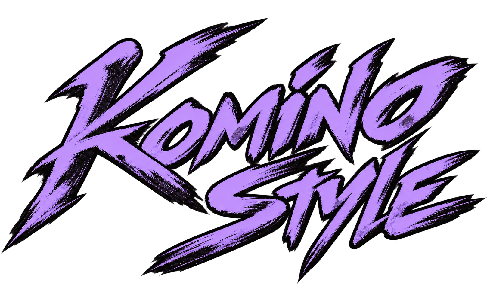
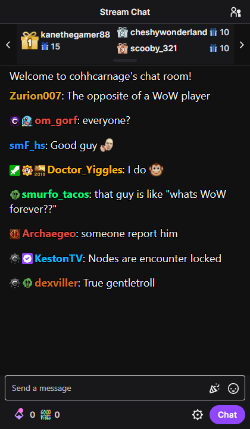
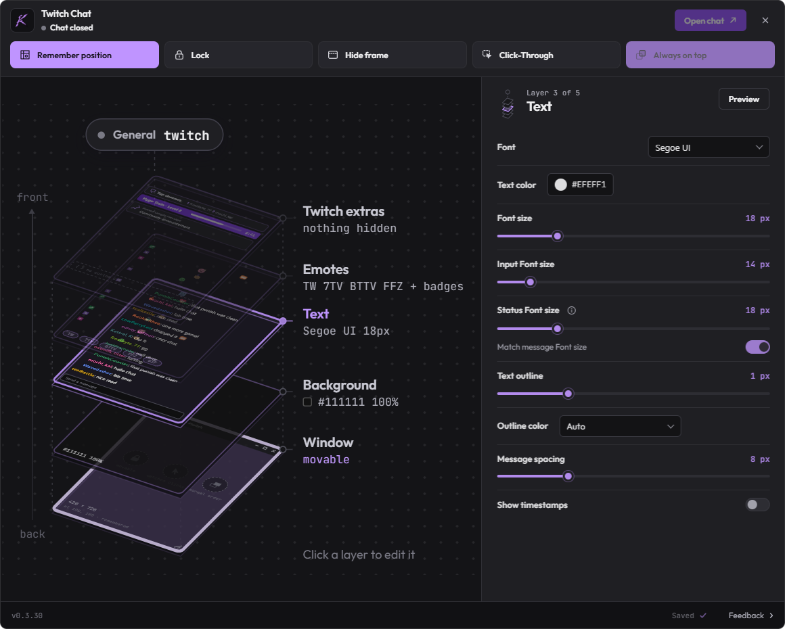

# Twitch Chat

Keep Twitch chat above your game. Adjust its background, text and emotes, then write directly in Twitch's chat input.

**[Download for Windows](https://github.com/KominoStyle/twitch-chat-installer/releases/latest/download/TwitchChat-Setup.exe)** · Windows x64

## Default chat

Default app appearance with Twitch's dark theme. Channel content varies.

## Appearance settings

## Get started

1. Download and run `TwitchChat-Setup.exe`. It downloads the current version and opens the installer.
2. In **General**, enter a channel and choose **Apply channel**.
3. Choose **Sign in to Twitch**. After sign-in, the channel chat opens.

Chat needs an internet connection and a Twitch account. Setup installs Microsoft WebView2 if it is missing.

Use the K in the Windows tray to open settings. Change colors, text size, emotes and window behavior there.

## Updates

Open **General → Updates** to check for a new version. When one is available, choose **Download update**, then **Install and restart**. Your settings and Twitch sign-in are kept.

## Uninstall

Choose **Quit** from the tray, then uninstall **Twitch Chat** in Windows Settings. Select **Also delete settings, Twitch sign-in and cached data** if you want to remove the saved app data too.

## Feedback

Use **Help & feedback** in General or **Feedback** at the bottom right of Settings to choose a form.

[Report a bug](https://github.com/KominoStyle/twitch-chat-installer/issues/new?template=01-bug-report.yml) · [Request a feature](https://github.com/KominoStyle/twitch-chat-installer/issues/new?template=02-feature-request.yml) · [Suggest an improvement](https://github.com/KominoStyle/twitch-chat-installer/issues/new?template=03-improvement-suggestion.yml)
