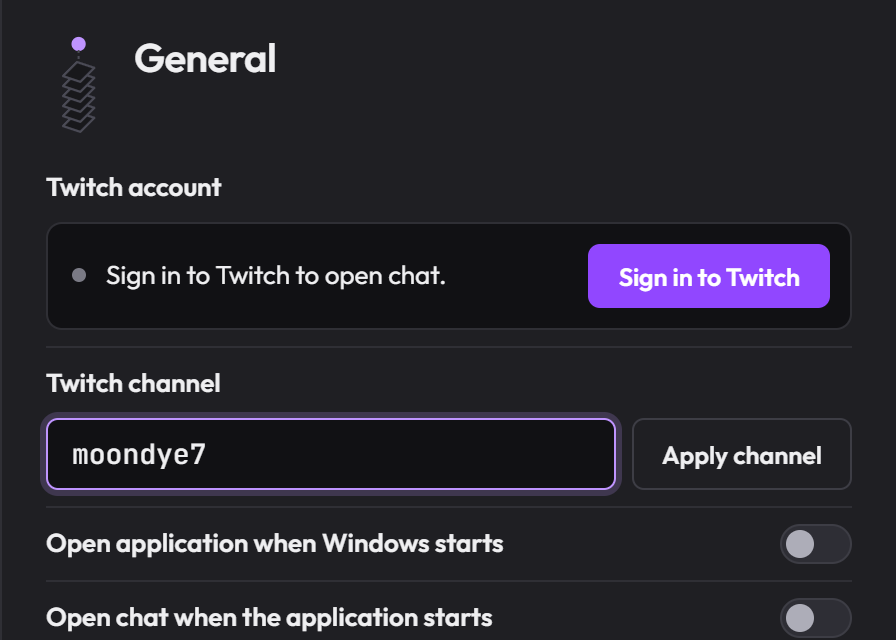
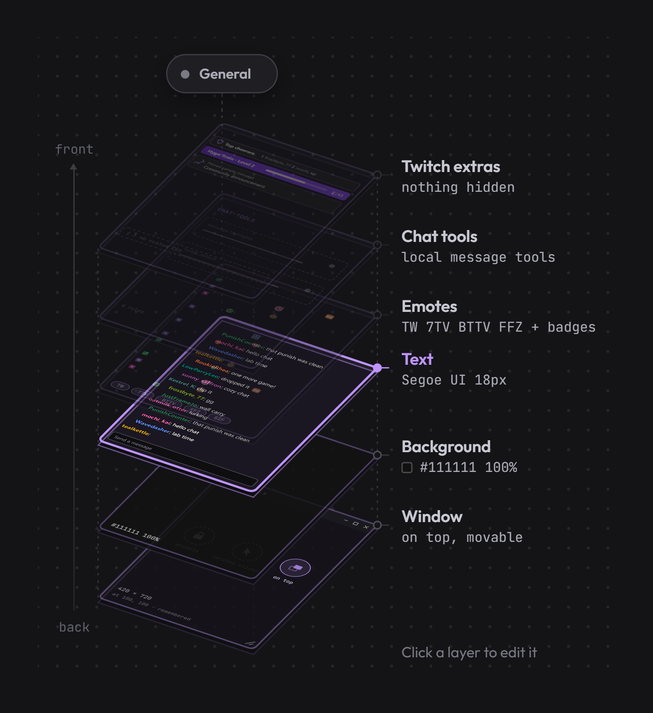
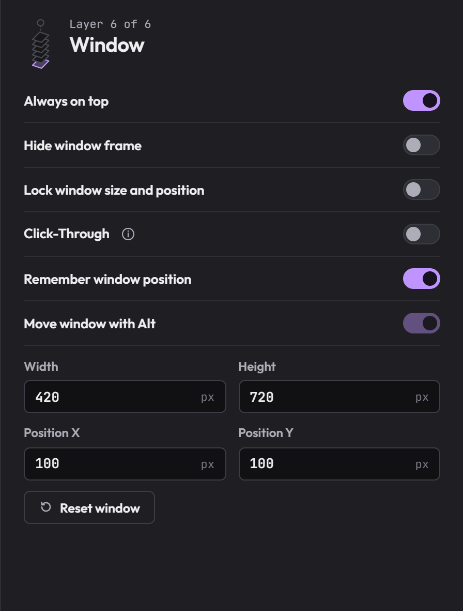
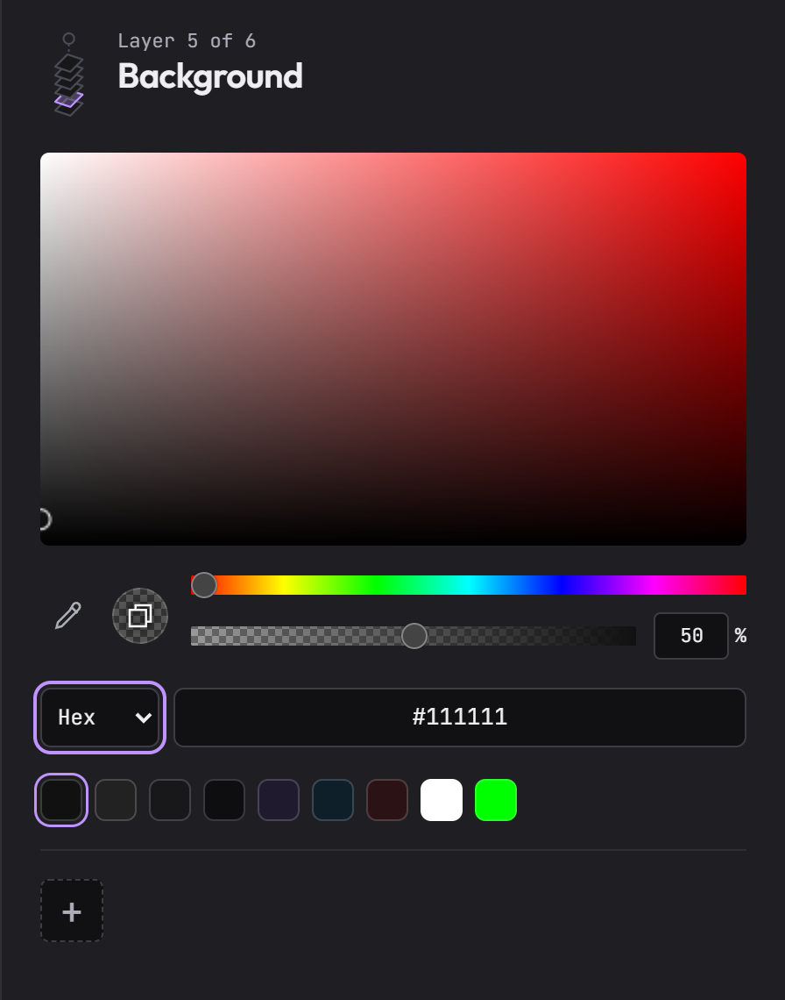
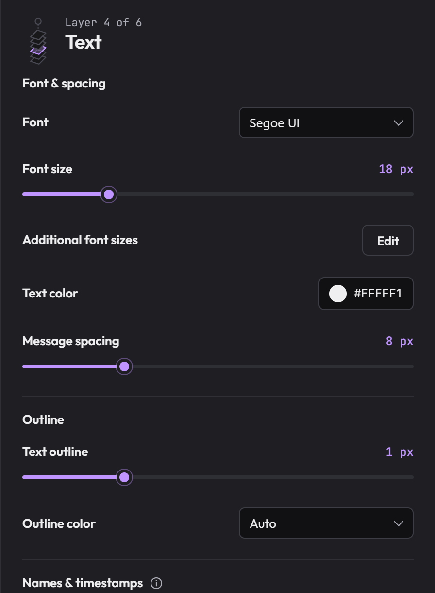
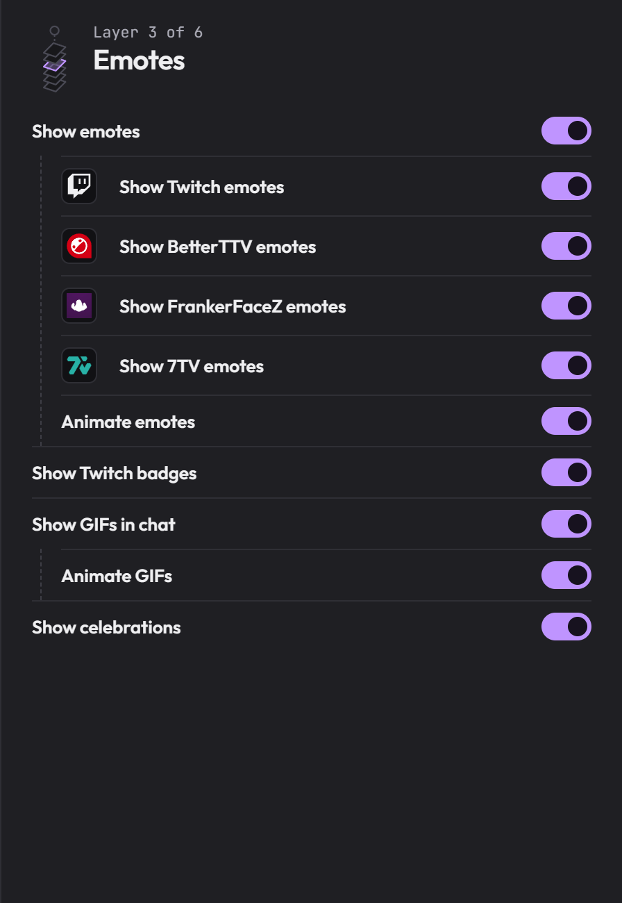
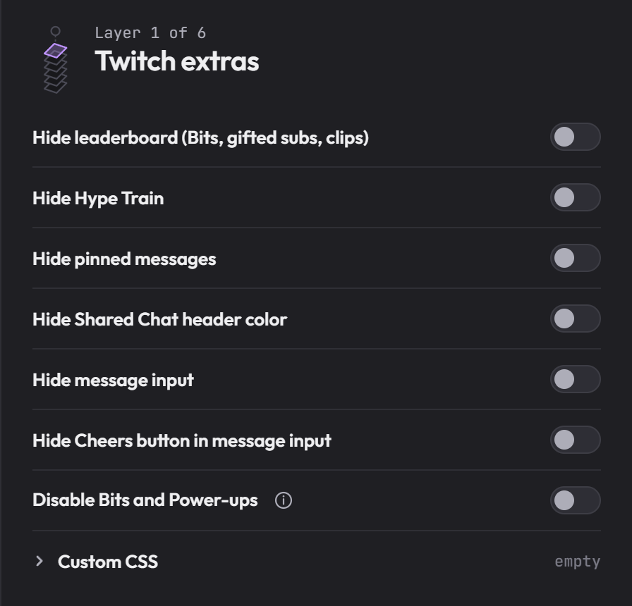
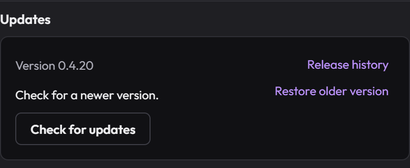
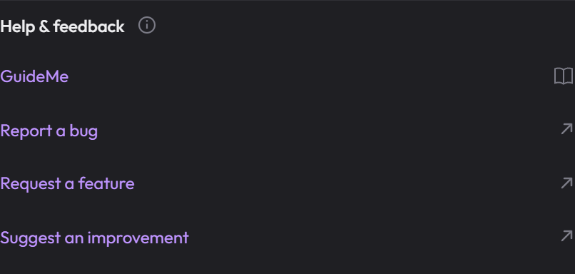

# Twitch Chat

For **public Stable 0.4.20** on Windows. Start here with the app's default settings.

For illustrated help inside the app, open **General → Help & feedback → GuideMe**. Start its **Quick Guide**, use **Explore Settings** to find a control, or open **Something's wrong?** for troubleshooting.

## Start chatting

Open Twitch Chat. **General** is the first page.

1. Enter the streamer's name in **Twitch channel**, for example `moondye7`.
2. Click **Apply channel**.
3. Click **Sign in to Twitch** and finish signing in in the Twitch window. Your selected chat opens after verification.

Next time, use **Open chat** at the top of Settings. The app has its own Twitch sign-in; signing in in your browser does not sign in here.

## Find a setting

Click the **K icon** near the Windows clock to open Settings. Click a layer's name or its illustrated plane to open that section.

1. **General:** account, channel, chat view, Windows startup, updates and GuideMe.
2. **Window:** movement, size, frame and Click-Through.
3. **Background:** color and transparency.
4. **Text:** font, sizes, outline and spacing.
5. **Emotes:** providers, animation and badges.
6. **Chat tools:** replies, threads, deleted messages, highlights, sounds, automatic claims and Raids.
7. **Twitch extras:** extra Twitch panels and input visibility.

Changes apply and save automatically. **Preview** shows sample text while you adjust the appearance. Closing Settings leaves the app in the tray. To exit the app, right-click K and choose **Quit**.

Drag an empty part of the Settings header to move it. Use the pin at the top right to keep Settings open when you click elsewhere. **General → Open application when Windows starts** is independent of **Open chat when the application starts**.

## Move and resize

Drag the chat's title bar to move it. Drag an edge or corner to resize it. **Lock** is off by default.

1. When the chat is where you want it, turn on **Lock window size and position** to prevent accidental movement.
2. For a borderless chat, turn on **Hide window frame**. Move it by dragging **Stream Chat**, or hold **Alt** and drag. Lock must be off to move it.

**Remember window position** is already on. **Reset window** restores the default position and size. **Click-Through** passes clicks through the background; input and chat controls remain clickable. Its background opacity limit is 90%.

## Change the background

Open **Background**. Choose a swatch, use the color square, or enter a Hex value.

1. Lower **Opacity** to see through the background. The example below uses 50%; the default is 100%.
2. Click **+** to save that color and opacity together. Click the saved tile to use it again.

Text and emotes remain visible at 0% background opacity. To separate text from what is behind it, adjust **Text outline** in Text.

## Adjust text size

Open **Text**:

1. **Font size** changes messages and message emotes. The default is 18px.
2. Open **Additional font sizes → Edit** for reply, reward, event, status and input sizes. **Input Font size** changes the editor where you type; its default is 14px. The other text sizes follow message size until you choose an independent value. **Match message Font size** turns matching back on and remembers your last independent size.

Font, text color, outline, spacing and timestamps are in this same section.

## Choose emotes

Open **Emotes**.

1. **Show emotes** controls message emote images. The switches below it let you choose providers and animation.
2. **Show Twitch badges** is separate, so turning emotes off does not remove badges.

In chat, open the emote menu beside the message input. You can also type an emote prefix and press **Tab** to cycle through matches; **Shift+Tab** goes back. Twitch decides which emotes your account may use.

## Hide Twitch panels

Open **Twitch extras**. These switches start off.

1. Turn on **Hide leaderboard** to remove the leaderboard. Hype Train and pinned messages have their own switches.
2. **Disable message input** hides the editor. Turn it off to show the editor again.

**General → Chat view** also offers **Messages and emotes only** and **Messages as text only** for a reading-only chat.

## Use Chat tools

Open **Chat tools** to choose reply and thread buttons, reading direction and alternating backgrounds. **Deleted messages**, **Message highlights**, **New message sound** and **Automatically join raids** have their own **Edit** pages.

Highlights can match words, sender names or badges, with colors, sounds and separate channel exceptions. New message sound is separate and applies to your own channel. Automatic claims use the original available Bonus Channel Points and earned Drops actions while Chat is open.

An automatic Raid from your open Chat minimizes the original Chat and opens the destination at the same position. Later Raids reuse that temporary Chat. **Close Chat** closes both. Choose destination channels in the Raid Edit page's **Blacklist** or **Whitelist**; Twitch's own Join and Leave actions remain available.

Open **GuideMe → 08 Chat tools** for the illustrated steps for each tool.

## Install an update

Open **General** and scroll to **Updates**.

1. Click **Check for updates**.
2. If an update is available, open **Release notes**, then choose **Download update**.
3. When the download is ready, choose **Install and restart**.

Updates keep your saved settings and app sign-in. Downloading and installing remain your choice.

## Get help

In **General**, scroll to **Help & feedback**. Choose the form that fits your question. It opens on GitHub in your browser.

Include your app version, shown at the bottom left of Settings. If saving fails, click **Unsaved changes · Retry** at the bottom of Settings to retry.
